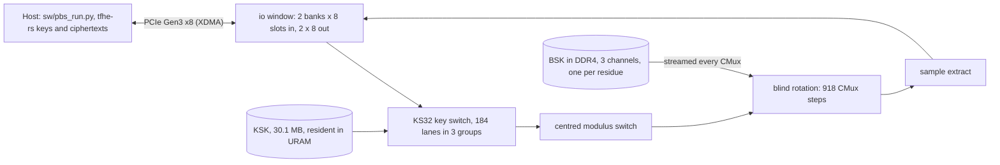

# opus_tfhe

A TFHE programmable-bootstrapping engine with key switching, running on a single SQRL BCU-1525 FPGA board (Xilinx xcvu9p, about $500 second-hand). Keys and input ciphertexts come from tfhe-rs, the whole key switch and bootstrap run on the card, and tfhe-rs decrypts the results. The design is custom SystemVerilog built from an empty directory against an exact-integer reference model. It matches that model bit for bit on every ciphertext measured.

Every figure here carries a provenance label: **silicon** (measured on the board), **sim** (Verilator testbench or the Rust model), **model** (a Vivado prediction) or **derived** (arithmetic on other figures). All throughput and latency figures are for the tfhe-rs 1.8.2 parameter set `PARAM_MESSAGE_2_CARRY_2_KS32_PBS_TUNIFORM_2M128`, p-fail 2^-129.58, at 250 MHz. [`sw/readme_numbers.py`](sw/readme_numbers.py) recomputes each one from the committed evidence; [`reproduce.sh`](reproduce.sh) regenerates the evidence on a board.

## Key figures

| Figure | What it is |
|---|---|
| **100,000** | bootstraps in the silicon gate (4 seeds × 2 runs × 12,500, no reprogramming), **0** tfhe-rs decryption failures, 0 mismatches against the model (silicon) |
| **3,569 PBS/s** | median sustained throughput over those 8 runs, engine busy-cycle clock, both banks kept full (silicon); 3,539 PBS/s by host wall clock (silicon) |
| **3.747 ms** | latency of one engine batch of 8, start to done (silicon) |
| **267 PBS/s** | throughput at batch 1, closed loop, engine clock (derived from silicon latency); 244 PBS/s by host wall clock (derived) |
| **35.8 PBS/W** | **a guess, not a measurement**: 3,569 PBS/s (silicon) over a 99.7 W Vivado estimate of the FPGA die alone (model). No watts were measured on the card |
| **+0.004 ns** | worst setup slack of the resident build 033 at 250 MHz, one clock domain (model) |

Beyond the gate: 179,000 bootstraps in the batch ladder on build 033, and 150,000 in a soak and 450,000 under a thermal-load run on build 029 (the same RTL, built with the earlier pin constraints), all with 0 failures (silicon).

## The ladder (Stage 4)

A request of B ciphertexts is handed to the card, the host waits for all B outputs, then sends the next request: one request in flight, so throughput at batch B is B divided by the request latency. That is how Zama's HPU figure "batch 2: 3,273 PBS/s at 611 µs" reads. The engine always runs 8 ciphertext slots, so batches of 1 to 8 cost one engine batch with the spare slots padded, and 12 or 16 cost two engine batches with both input banks started at once.

**Device** latency is the engine's busy-cycle counter over the request at 250 MHz. **Host** latency is the host's wall clock from the first DMA write to the last DMA read, so it includes PCIe transfers and Python polling. Medians over 4 seeds × 750 requests each, all for `PARAM_MESSAGE_2_CARRY_2_KS32_PBS_TUNIFORM_2M128` at p-fail 2^-129.58; evidence [`evidence/stage4/ladder/`](evidence/stage4/ladder/).

| Batch | Device latency (silicon) | PBS/s, device (derived) | Host latency (silicon) | PBS/s, host (derived) |
|--:|--:|--:|--:|--:|
| 1 | 3.747 ms | 267 | 4.09 ms | 244 |
| 2 | 3.747 ms | 534 | 4.14 ms | 483 |
| 4 | 3.747 ms | 1,068 | 4.20 ms | 953 |
| 8 | 3.747 ms | 2,135 | 4.34 ms | 1,843 |
| 12 | 5.892 ms | 2,037 | 6.34 ms | 1,892 |
| 16 | 5.892 ms | 2,716 | 6.47 ms | 2,472 |
| stream | 3.747 ms per engine batch | 3,569 (busy cycles) | | 3,539 (wall) |

- The stream row is the Stage 3 gate: 12,500 ciphertexts per run, both banks kept full, so a new engine batch starts every ~2.2 ms while each one takes 3.747 ms.
- Batch 12 and 16 cost 5.892 ms, not 2 × 3.747 ms: the second engine batch overlaps the first by ~1.6 ms. Starting each slot's blind rotation as soon as its own key switch finishes is where batch-1 latency would come from.
- The ladder ran with the shared host at a load average near 15 on 48 cores from other people's jobs. Its own stream rows gave 3,531 to 3,625 PBS/s on busy cycles, against the gate's median of 3,569 (silicon). The median device latencies agree to within a microsecond across all four seeds.

## Beside the published numbers

Parameter sets differ between rows; each row names its own.

| Design | Device | Result | Parameter set, p-fail | Power | Tag |
|---|---|---|---|---|---|
| **opus_tfhe (this)** | BCU-1525 (VU9P, DDR4) | **3,569 PBS/s** streaming, 3.747 ms per batch of 8; 267 PBS/s at batch 1 | `PARAM_MESSAGE_2_CARRY_2_KS32_PBS_TUNIFORM_2M128`, 2^-129.58 | 99.7 W die (model, a guess), 35.8 PBS/W (guessed: derived from the model) | silicon |
| Zama HPU | Alveo V80 (HBM2e) | 14,167 KS-PBS/s at batch 12, 847 µs; batch 2: 3,273 PBS/s at 611 µs | `HPU_PARAM_MESSAGE_2_CARRY_2_KS32_PBS_TUNIFORM_2M128`, 2^-128 | not published | vendor claim |
| Reyes Häusler et al. | VCU128 (VU37P, HBM2) | 10,156 PBS/s, PBS only (the key switch is not implemented) | 64-bit Goldilocks, n=500, N=1024, DFR 2^-64 | 119 W; printed 171 PBS/W counts each PBS twice, 85 PBS/W per PBS (derived) | preprint |
| FPT (CCS 2023) | Alveo U280 | 25,000 PBS/s at DFR 2^-15; 5,860 PBS/s normalised to 2^-64 | 32-bit torus | 99 W | peer-reviewed |
| tfhe-rs CUDA | one H100 | multi-bit KS-MB-PBS 973 µs; classic KS-PBS 3.58 ms (2-bit) | `PARAM_GPU_MULTI_BIT_GROUP_4_MESSAGE_2_CARRY_2_KS_PBS`, 2^-128 | n/a | vendor benchmark |

In plain sentences:
- At 3,569 PBS/s on `PARAM_MESSAGE_2_CARRY_2_KS32_PBS_TUNIFORM_2M128` with p-fail 2^-129.58 (silicon), this engine reaches about a quarter of Zama HPU's 14,167 KS-PBS/s on `HPU_PARAM_MESSAGE_2_CARRY_2_KS32_PBS_TUNIFORM_2M128` with p-fail 2^-128 (vendor claim). The HPU's V80 has 10,848 DSPs and HBM2e, against 6,840 DSPs and DDR4 here.
- At batch 2, this engine gives 534 PBS/s at 3.747 ms on `PARAM_MESSAGE_2_CARRY_2_KS32_PBS_TUNIFORM_2M128`, p-fail 2^-129.58 (silicon, derived), against the HPU's 3,273 PBS/s at 611 µs on `HPU_PARAM_MESSAGE_2_CARRY_2_KS32_PBS_TUNIFORM_2M128`, p-fail 2^-128 (vendor claim). Its latency is about 6× longer.
- The VCU128 processor's 10,156 PBS/s is a bootstrap without key switch at DFR 2^-64 on a 64-bit set with n=500 and N=1024 (preprint). Its printed 171 PBS/W counts each bootstrap twice, so it is 85 PBS/W per bootstrap (derived). Against that: 3,569 PBS/s with the key switch, and a guessed 35.8 PBS/W (derived from a Vivado power estimate, nothing measured), here at p-fail 2^-129.58 on `PARAM_MESSAGE_2_CARRY_2_KS32_PBS_TUNIFORM_2M128`. Its failure probability is 2^65 times looser, and it states a power figure without a method.

The charter's targets: **T0** (correct PBS on silicon, decrypting in tfhe-rs) is met. **T1** (≥ 5,000 PBS/s), T2, T3, the latency targets (under 611 µs and 973 µs) and the efficiency target (above 171 PBS/W, the VCU128 paper's printed figure) are not. The efficiency figure is itself a guess, so even that comparison is an estimate.

## How it works



- **Arithmetic.** The engine works in Z_Q with Q = 249857 · 188417 · 163841, three NTT-friendly primes, one residue per SLR. This is not the tfhe-rs FFT; the reference model in [`ref/tfhe_model`](ref/tfhe_model) shows the residue arithmetic gives the same decryptions, and the RTL matches that model bit for bit.
- **Blind rotation.** Each of the 918 CMux steps is an external product: gadget decomposition, a streaming negacyclic NTT with 32 lanes per residue, pointwise multiply-accumulate with the BSK row, and the inverse NTT. Eight ciphertext slots are interleaved so the pipeline stays full: 918 × 8 × 64-cycle frames is the 470,016-cycle bound per batch, and the engine alone reaches 478,414 cycles (sim).
- **Key switch.** KS32 on 184 lanes: 45,989 cycles per ciphertext, hidden under the previous batch's blind rotation (sim). It and the centred modulus switch are bit-identical to tfhe-rs (sim).
- **Memory.** The 30.1 MB KSK stays resident in UltraRAM. The BSK (50.8 MB in engine form) lives in DDR4 and is streamed for every batch, one channel per residue.

## Where the time goes

| Stage | Cycles per batch of 8 | Label |
|---|--:|---|
| blind-rotation bound (918 × 8 × 64) | 470,016 | derived |
| engine alone | 478,414 | sim |
| engine + shell, DDR4 model with latency and gaps | 512,168 | sim |
| best silicon run (3,622 PBS/s) | 552,200 | derived from silicon |
| median silicon (3,569 PBS/s) | 560,400 | derived from silicon |

One batch from start to done takes 3.747 ms = 936,700 cycles on silicon, against 895,103 in simulation: the first key switch of the batch is not overlapped, and each slot waits for all eight to be switched.

## Fitting the device

Build 033, routed, `xcvu9p-fsgd2104-2L-e` (model):

| Resource | Used | Device |
|---|--:|--:|
| LUT | 805,630 | 1,182,240 |
| FF | 739,243 | 2,364,480 |
| BRAM36 | 800.5 | 2,160 |
| URAM288 | 856 | 960 |
| DSP48E2 | 5,022 | 6,840 |

Everything runs on the single 250 MHz XDMA clock. The whole engine closed at 300.1 MHz out of context (model), but in the full design with the PCIe and DDR4 shell it closes at 250 MHz with +0.004 ns setup and +0.004 ns hold slack (model). Build 033 is build 029's placement rerouted incrementally with the generated DDR4 pin constraints (99.6% of nets reused). A fresh build with the same constraints and the same commit (build 032, not programmed) also closed, at +0.000 ns.

## Power

The card's VCCINT regulator (an LTC3884 on PMBus) is wired only to the board controller and to a header, not to any FPGA pin. A read-only probe of the board controller's USB UART got no bytes on any port at 7 baud rates. So **no card watts were measured**. Every power and PBS/W figure here is a guess: a Vivado estimate on the routed build 033 (model), with assumed switching activity:

- **99.7 W** on-chip with the engine's registers, shift registers, LUT-RAM and DSP outputs at 50% toggle, the right activity for uniformly random ciphertext and key data; 77.4 W of it is the engine.
- 90.3 W with Vivado's vectorless default. Vivado rates both "Low" confidence (no simulation activity file).
- **35.8 PBS/W (a guess)** = 3,569 PBS/s (silicon) / 99.7 W (model), on `PARAM_MESSAGE_2_CARRY_2_KS32_PBS_TUNIFORM_2M128` at p-fail 2^-129.58, batch 8. FPGA die only: no DIMMs, no regulator losses. The real card figure could differ substantially either way: Vivado's estimate rests on assumed toggle rates, and the card draws more than the die.
- Die temperature over JTAG, on build 029 (the same RTL; silicon): 68.6 °C idle, 71.8 °C under a 450,000-bootstrap load. That drift did not decay when the load stopped, so no load step is resolvable and no watts are inferred from it.

A USB-PMBus adapter on header J1 would give a measured VCCINT figure. Method and data: [`evidence/stage3/power/SUMMARY.md`](evidence/stage3/power/SUMMARY.md).

## Correctness

- tfhe-rs 1.8.2 generates the keys and encrypts the inputs ([`ref/tfhe_oracle`](ref/tfhe_oracle)). Every output from the card is compared bit for bit with the reference model and decrypted by tfhe-rs.
- Silicon gate: 100,000 bootstraps, 0 failures, output noise log2 std 49.02 to 49.04 (silicon). Evidence: [`evidence/stage3/silicon_033/SUMMARY.md`](evidence/stage3/silicon_033/SUMMARY.md).
- Noise at scale before silicon: 250,000 model bootstraps and a 300,000-output worst-case chain (scale by 5, bootstrap again), decrypted by tfhe-rs with 0 failures (sim, [`evidence/stage2/validate_25k/`](evidence/stage2/validate_25k/)).

## Known hazards

The ways it went wrong on first silicon, each fixed and on the record:

- **Unaligned host buffers:** the DMA engine splits a transfer at the source's page boundaries, and the io window takes whole 32-byte beats. Inputs from ordinary Python buffers landed off the beat grid and 14 of 16 outputs were wrong, as clean but wrong lookup values. The host now stages every write through a page-aligned buffer. The DDR4 path hides this, so a passing memory test proves nothing about the io window.
- **A free-running 32-bit counter:** the batch scheduler compared against a cycle counter that wraps every 17.18 s. A batch that straddled the wrap stalled for 2^32 cycles. No simulation runs 17 s, so a testbench now starts the counter near the wrap and sweeps 64 phases: 57 of 64 pass on the old RTL, 64 of 64 on the fix.
- **A host race on the status word:** the host judged which bank finished by a status read taken after a counter read. Fixed by the order of reads; inferred from the code, as the one abort it explains was not reproduced.

## The method

The project's rules: an exact reference model before any RTL; simulation gates before silicon; four seeds, each run twice without reprogramming, for every hardware claim; fresh routed reports only; the version register traces the bitstream to its git commit; and evidence for every claim committed under [`evidence/`](evidence/). The design is clean-room: Zama's HPU RTL and documentation were never opened.

This was an experiment in AI-assisted engineering: the work was directed by a human and carried out by Claude (Anthropic). The design is described in [`docs/ARCHITECTURE.md`](docs/ARCHITECTURE.md), the parameters and engine arithmetic in [`docs/PARAMS.md`](docs/PARAMS.md), and the file formats in [`docs/FORMATS.md`](docs/FORMATS.md).

## Honest limitations

- **Throughput is a quarter of the best vendor number**, and batch-1 latency is 3.747 ms, about 6× the HPU's 611 µs.
- **Performance per watt is a guess.** No card-level watts were measured; 35.8 PBS/W divides measured throughput by a Vivado power estimate.
- **The parameter set is the KS32 sibling** of the classic 2M128 set (same bootstrap, same p-fail), because the classic set's 60 MB key-switching key cannot sit on chip.
- **Timing margin is effectively zero** (+0.004 ns), inside the placer's run-to-run spread.
- **The host is a shared server.** Host-clock figures move with its load; device-clock figures do not.
- **Reproducing this needs this board** (BCU-1525) and a Vivado seat.

## Reproduce

```bash
./reproduce.sh numbers          # every README figure from committed evidence (no board)
./reproduce.sh data             # tfhe-rs keys + inputs + model outputs, seeds 1-4
./reproduce.sh build            # Vivado build of the full design (hours, needs a VU9P licence)
./reproduce.sh program <bit>    # volatile JTAG programming via the safe PCIe remove/rescan flow
./reproduce.sh gate             # 4 seeds x 2 runs x 12,500 on the board
./reproduce.sh ladder           # batch 1..16 ladder on the board
./reproduce.sh power            # Vivado power estimate + SYSMON idle/load temperatures
```

The board steps use the lab's shared board lock and safe reprogramming script (`board_lock.py`, `program_fpga.sh` from the author's fable5_llm project; paths are variables at the top of `reproduce.sh`).

## License and provenance

Apache-2.0 (see [`LICENSE`](LICENSE)); read [`NOTICE`](NOTICE) first: TFHE techniques may be covered by Zama patents, and commercial use needs a patent review. tfhe-rs is a linked test oracle, fetched by cargo and not distributed here. The DDR4 pin constraints and part file are generated by [`synth/scripts/gen_ddr4_constraints.py`](synth/scripts/gen_ddr4_constraints.py) from AMD/Xilinx's Apache-2.0 VCU1525 board file and JEDEC timings; see [`synth/constraints/PROVENANCE.md`](synth/constraints/PROVENANCE.md). Git history before commit 55306ef holds earlier GPLv2 community versions of those files.
